# Wazuh Rebuild: Build Log

> [!IMPORTANT]
> The subnets and device IP addresses on this page are for demonstration only. They
> are not the ones I actually use. I keep the real addressing out of this repo for
> security reasons.

**Date:** 2026-10-15 to 2026-10-__  
**OS:** Ubuntu 26.04.1 LTS (Latitude 5420), Raspberry Pi OS, pfSense, macOS  
**Environment:** Homelab  
**Category:** SIEM, Logging, Detection, Hardening  
**Status:** In progress. The network prep (steps 0 and 0.5), the Wazuh install (step 1), the Trusted MacBook Air exception (step 1.5), the host firewall (step 2), the agents (step 3) and the pfSense logs (step 4) are done; the Pi-hole logs (step 5) are next

The plan is in the [README](../README.md). This page is the working log: what I
did, in order, and what broke along the way. Screenshots live in [`../images/`](../images/).
Notes from the first build are in [`archive-2026-07/`](archive-2026-07/).

---

## Situation

_What did the first build do, and why rebuild it?_

- What the first build collected, and where it ran:
- Why it no longer runs:
- What prompted the rebuild (network logs, not just host logs):

## Task

Rebuild Wazuh as a single node on a Dell Latitude 5420 (32 GB) so it collects logs from the
network itself, and prove each source reaches the dashboard. The 5420 sits on switch port 7,
in the Servers VLAN, at 10.0.50.30 in this demo scheme.

| Source | Where it runs | How it reaches Wazuh | Why |
|---|---|---|---|
| pfSense firewall | Router | Remote syslog, UDP 514 | Blocked and allowed traffic between VLANs |
| Pi-hole | Raspberry Pi 2 | Agent, or rsyslog (reason written down) | DNS queries from every device |
| Latitude 5420 (the Wazuh server) | Servers VLAN, switch port 7 | Wazuh agent | File integrity and CIS checks on the server |
| MacBook Air | Trusted VLAN | Wazuh agent (the one Trusted agent) | File integrity and CIS checks on a daily-use machine |

Done when: every row of the verification matrix below passes, or the failure is documented.

## Action

Tick each item when it is done and the evidence is saved. Add the date to each step.

### 0. Before touching anything — Date: 2026-10-15

- ✅ Segmentation build finished and the test matrix passed (passed 2026-10-09)
- ✅ The 5420 is on switch port 7, which moves from the Trusted spare to Servers: untagged in VLAN 50, PVID 50, excluded from VLAN 1
  Port 7 renamed SIEM; member of VLAN 50 only (50*).

  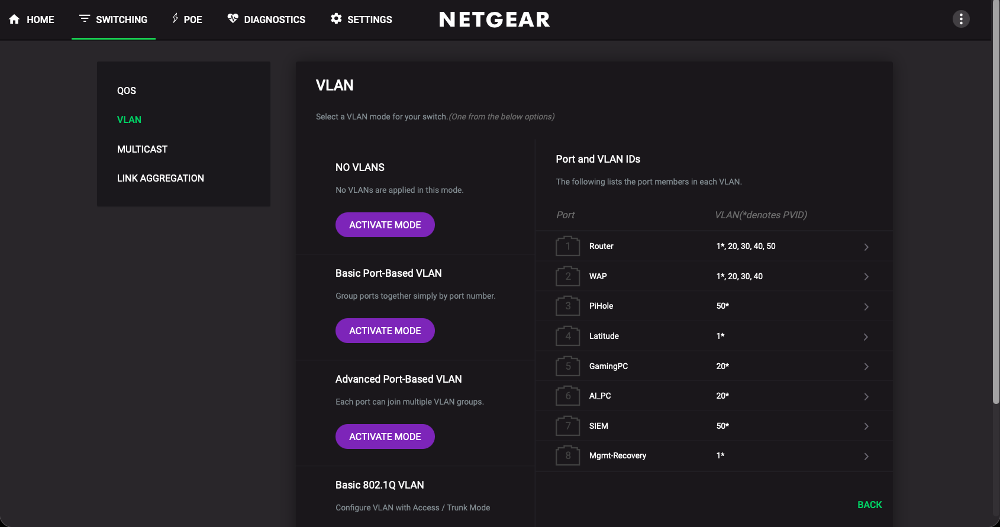

  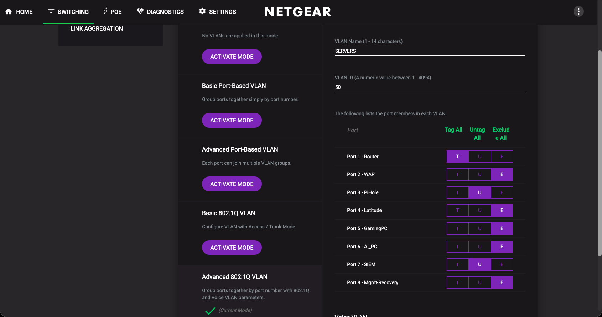

- ✅ The 5420 has a static Servers address (10.0.50.30 in this demo scheme)
  Verified from wired Mgmt: ping and SSH work; host key matches the old Trusted address.
- ✅ Free disk space and RAM on the 5420 checked and written down
  Ubuntu 26.04.1 LTS · 30 GB RAM, 8 GB swap · root LVM 98 GB, 82 GB free.
- ✅ Config backups of pfSense and the Pi-hole taken
- [ ] Old first-build notes moved to `archive-2026-07/` (done)

### 0.5 pfSense: let the Wazuh server reach the internet — Date: 2026-10-15

_Why: the only Servers pass rule today is the Pi-hole's, so a second server on Servers would have no internet to pull Docker images or updates. Its DNS goes to the Pi-hole on the same VLAN, so DNS needs no rule._

| Interface | Action | Source | Destination | Port | Why |
|---|---|---|---|---|---|
| Servers | Pass | `WAZUH_SERVER` | any | TCP/UDP `WAZUH_OUT_PORTS` (80, 443, 123) | Image pulls, updates and time. It sits below the Servers blocks, because first match wins |

- ✅ Create the alias `WAZUH_SERVER` (the 5420's Servers address)
- ✅ Add the rule below the two Servers block rules
- ✅ Verify from the 5420: HTTPS to the internet works, and a connection to another VLAN times out
- ✅ Evidence: the rule, and the two test results

Aliases `WAZUH_SERVER` (host) and `WAZUH_OUT_PORTS` (80, 443, 123); one TCP/UDP pass rule at the bottom of SERVERS, below both block rules.

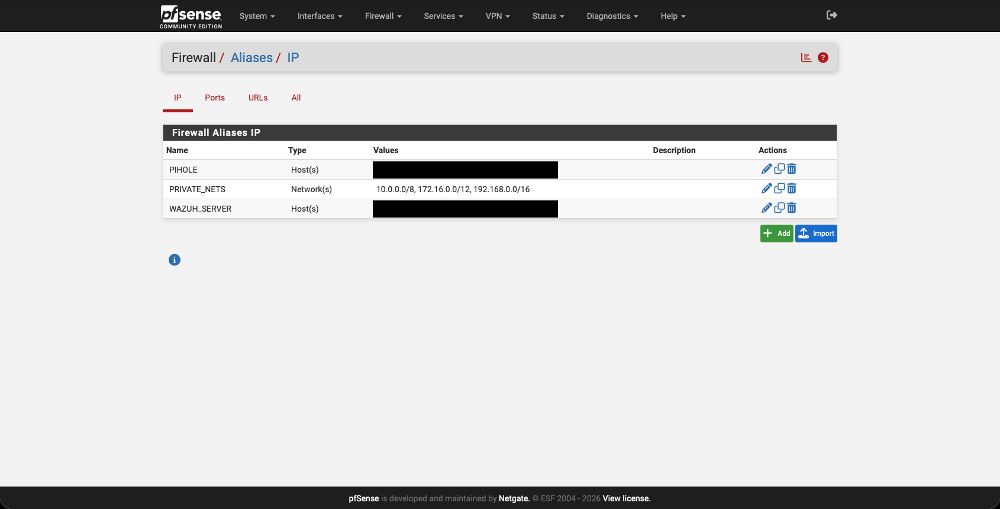

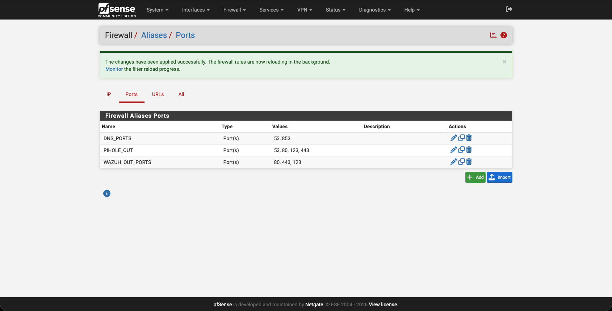

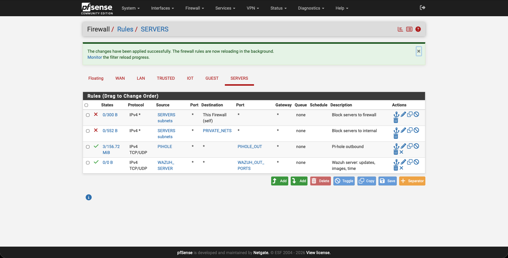

**Test results (from the 5420)**

```
curl -sI https://ubuntu.com             -> HTTP/2 200
apt update                              -> mirrors reached
timedatectl                             -> synchronized: yes
nc to the switch on Mgmt, port 80       -> timed out
```

ICMP out stays blocked by design.

### 1. Wazuh single node on the Latitude 5420 — Date: 2026-10-15

- ✅ Docker and Docker Compose confirmed working
- ✅ Single-node Wazuh stack deployed (indexer, manager, dashboard)
- ✅ Dashboard published on host port 8443 (443 stays free for NextCloud); reached from the MacBook Air through the step 1.5 rule
- ✅ Evidence: screenshot of the dashboard after first login

**What I installed and set**

| Item | Value |
|---|---|
| Docker | 29.1.3, from the Ubuntu package `docker.io` |
| Docker Compose | 2.40.3, from the Ubuntu package `docker-compose-v2` |
| Kernel setting | `vm.max_map_count=262144`, in `/etc/sysctl.d/99-wazuh.conf` |
| Wazuh | wazuh-docker v4.14.9, single-node, in `~/wazuh-docker/single-node` |
| Certificates | generated with `generate-indexer-certs.yml` |
| Indexer heap | 4 GB (`OPENSEARCH_JAVA_OPTS=-Xms4g -Xmx4g`) |
| Dashboard port | published as `8443:5601`, so 443 stays free |

**Admin password.** I replaced the default admin password before the first start. I made the hash with the indexer's `hash.sh`, wrote it to `config/wazuh_indexer/internal_users.yml`, and set `INDEXER_PASSWORD` in `docker-compose.yml` to match. The password and the hash are not in this repo. My first attempt at doing this after the first start failed; see Problem 2.

**Open item for step 2.** Docker publishes 1514-1515/tcp, 514/udp, 55000/tcp, 9200/tcp and 8443/tcp on all interfaces, and that traffic bypasses ufw. Step 2 restricts 9200 and 55000 with the `DOCKER-USER` chain.

**Screenshots**

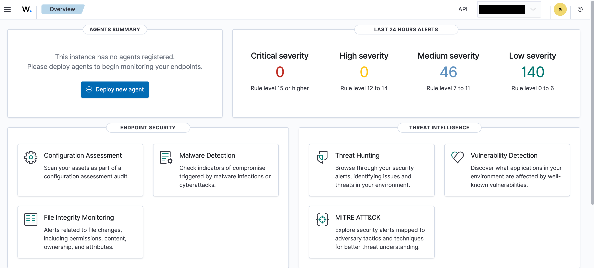

_Wazuh dashboard after first login, no agents yet._

_Placeholder: Running containers_ — the three Wazuh containers up and healthy  
<!--  -->

### 1.5 pfSense: one narrow Trusted exception for Wazuh — Date: 2026-10-15

_Why: the Trusted rules block every internal network, so nothing on Trusted can reach the Wazuh server (the 5420). The MacBook Air is the one Trusted device that needs it: it is the one Trusted agent and the only dashboard client. I'm opening one narrow rule for it, not wired Mgmt access and not a general Trusted-to-Servers path._

| Interface | Action | Source | Destination | Port | Why |
|---|---|---|---|---|---|
| Trusted | Pass | `WAZUH_MAC_AIR` | `WAZUH_SERVER` (the 5420, 10.0.50.30) | TCP `WAZUH_PORTS` (1514, 1515, 8443) | The MacBook Air is the one Trusted agent (1514 events, 1515 enrollment) and the only dashboard client (8443). It sits above "Block trusted to internal", because first match wins |

Everything else from Trusted to the 5420 stays blocked.

- ✅ Give the MacBook Air a DHCP static mapping on the Trusted VLAN
- ✅ Create the alias `WAZUH_MAC_AIR` (the MacBook Air's Trusted address) and the port alias `WAZUH_PORTS` (1514, 1515, 8443)
- ✅ Add the rule above, above "Block trusted to internal"
- ✅ Verify from the MacBook Air: the dashboard loads on 8443, and other ports on the 5420 (SSH) still time out
- ✅ Verify from another Trusted address: the dashboard and the agent ports time out
- ✅ Evidence: the aliases, the rule, and the test results

**What I set**

- The MacBook Air's Wi-Fi "Private Wi-Fi address" is set to Fixed, so its MAC stays stable and the static mapping keeps matching.
- DHCP static mapping on Trusted: the MacBook Air at 10.0.20.30 (demo address).
- Alias `WAZUH_MAC_AIR` (host) and port alias `WAZUH_PORTS` (1514 agent events, 1515 agent enrollment, 8443 dashboard).
- Pass rule on TRUSTED: TCP, `WAZUH_MAC_AIR` to `WAZUH_SERVER` on `WAZUH_PORTS`, placed above "Block trusted to internal".

**Test results** (from the MacBook Air on Trusted Wi-Fi, Ethernet unplugged)

| Test | Result |
|---|---|
| Dashboard, 8443 | Succeeded |
| Agent events, 1514 | Succeeded |
| SSH, 22 | Timed out |
| Same Mac at a different Trusted address (before its lease renewed), 8443 and 1514 | Timed out, which shows other Trusted addresses are blocked |

**Note:** a second household laptop may be added later. The plan is a second host alias inside a group alias, so the rule stays one rule.

**Screenshots**

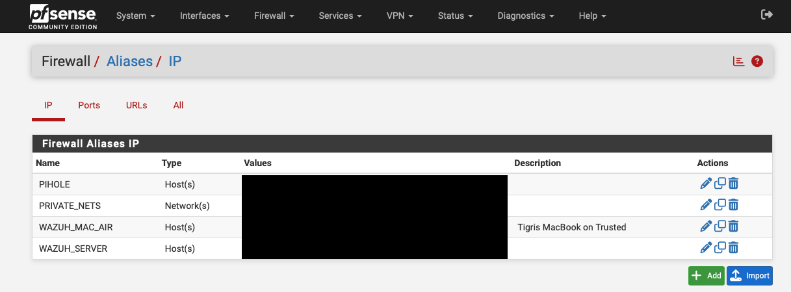

_IP aliases, addresses redacted._

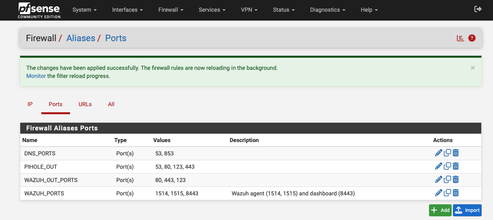

_Port aliases._

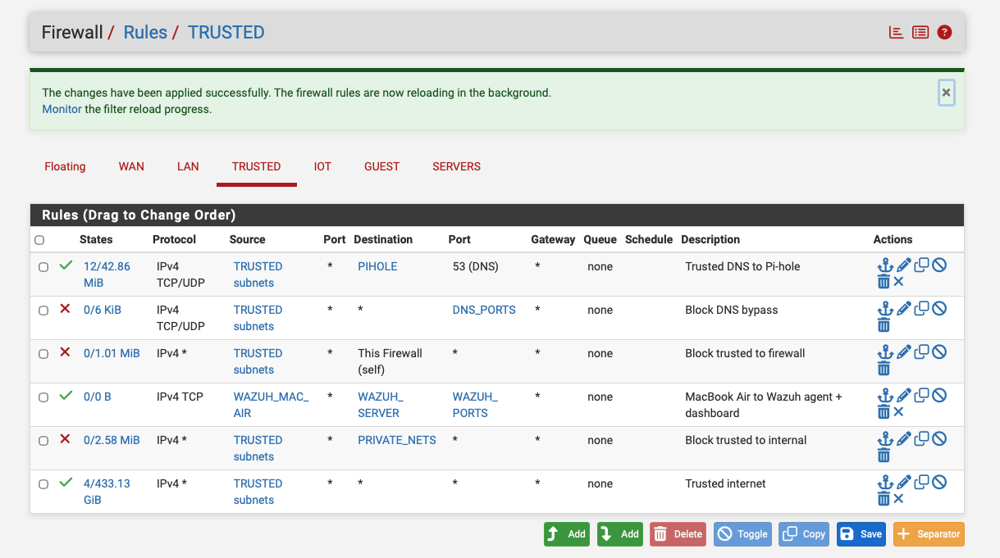

_TRUSTED rules with the Wazuh exception above the internal block._

### 2. Host firewall and agent ports — Date: 2026-10-15

- ✅ List open ports on the 5420 and note why each is open
- ✅ Allow agent traffic only from the machines that need it: the MacBook Air (through the rule in step 1.5), the Pi-hole and pfSense
- ✅ Confirm the agent ports are not reachable from IoT, Guest or any Trusted device except the MacBook Air
- ✅ Evidence: the open-port findings, the firewall changes and the test results, recorded below as text
- [ ] Confirm the rules survive a reboot of the Wazuh server (not tested yet)

**Open-port review.** `ss -tulpn` showed Docker publishing 514/udp, 1514, 1515, 8443, 9200 and 55000 on all interfaces, plus SSH on 22.

| Port | Why it is open |
|---|---|
| 1514/tcp | Agent events |
| 1515/tcp | Agent enrollment |
| 514/udp | Syslog (pfSense, Pi-hole) |
| 8443/tcp | Dashboard |
| 9200/tcp | Indexer; only the dashboard and manager need it, inside Docker |
| 55000/tcp | Wazuh API; only the dashboard needs it, inside Docker |
| 22/tcp | SSH for admin |

**What I changed**

- **9200 and 55000 bound to 127.0.0.1** in `docker-compose.yml`. The dashboard reaches them inside Docker, so nothing outside needs them.
- **ufw enabled:** default deny incoming, allow outgoing. SSH (22) is allowed only from the Mgmt subnet.
- **DOCKER-USER block in `/etc/ufw/after.rules`.** Docker-published ports bypass ufw, so ufw alone doesn't protect them. The block allows established traffic, allows new connections only from the Mgmt subnet, the MacBook Air, pfSense's Servers address and the Pi-hole, and drops everything else.

This filters by source, not per port. Per-port rules are a possible later tightening.

**Tests** (all passed)

| From | Test | Result |
|---|---|---|
| MacBook Air | 8443 | Succeeded |
| MacBook Air | 9200, 55000 | Timed out |
| Pi-hole | 1514 | Succeeded |
| Pi-hole | SSH (22) | Timed out |
| pfSense (Diagnostics > Test Port), Trusted address | 1514 | Failed (not on the allow list) |
| pfSense (Diagnostics > Test Port), Servers address | 1514 | Succeeded |

**Not yet tested:** that the rules survive a reboot of the Wazuh server.

### 3. Agents: the Wazuh server and MacBook Air — Date: 2026-10-15

- ✅ Agent enrolled on the Wazuh server (the 5420)
- ✅ Agent enrolled on the MacBook Air (the one Trusted agent)
- ✅ Both agents show as active in the dashboard
- ✅ File integrity monitoring and SCA running on both
- ✅ Evidence: screenshot of the agents list

**What I did**

- **Wazuh server:** added the Wazuh apt repository and installed `wazuh-agent` 4.14.9-1 with `WAZUH_MANAGER=127.0.0.1`, because the manager runs in Docker on the same host. I held the package with `apt-mark hold` so it can't upgrade past the manager.
- **MacBook Air:** installed `wazuh-agent` 4.14.9-1 (arm64 .pkg) with the manager address 10.0.50.30 (demo). It already had an agent from the first build; see Problem 4.
- **Dashboard:** both agents are active: 001 `spyrosiemlab` (Ubuntu) and 002 the MacBook Air (macOS).
- **Monitoring:** FIM started on both. SCA ran the CIS macOS policy on the Mac.

**Open item for step 6.** SCA on the Wazuh server finished in 0 seconds, so there may be no CIS policy for its Ubuntu release yet. Check this before step 6.

**Screenshots**

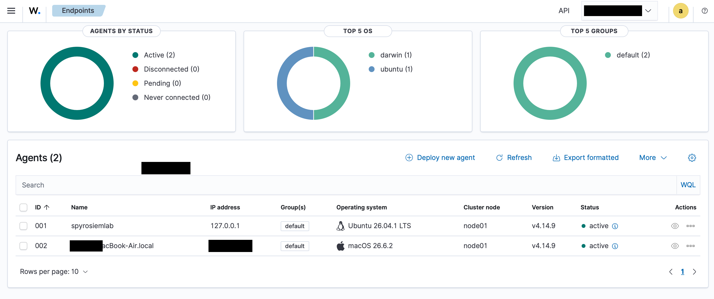

_Both agents active; the Mac's address redacted._

### 4. pfSense logs into Wazuh — Date: 2026-10-15

- ✅ Remote syslog on pfSense pointed at the Wazuh host (UDP 514)
- ✅ Wazuh set to receive and parse the syslog
- ✅ A blocked connection between VLANs shows up in the dashboard
- ✅ Evidence: screenshot of a pfSense event in Wazuh

**Wazuh manager.** I added a syslog `<remote>` block (UDP 514, `allowed-ips` set to pfSense's Servers address) to `config/wazuh_cluster/wazuh_manager.conf`. The manager didn't pick it up at first; see Problem 5.

**pfSense.** Status > System Logs > Settings:

| Setting | Value |
|---|---|
| Remote logging | On |
| Source address | `SERVERS` |
| Remote log server | The Wazuh host, port 514 (10.0.50.30 in this demo scheme) |
| Remote syslog contents | Firewall Events |
| Log message format | BSD (RFC 3164) |

I also enabled logging on the "Block ... to internal" rules on TRUSTED, IOT and GUEST, so blocked inter-VLAN attempts are the events that get sent.

**Custom decoder and rules.** pfSense's BSD format has no hostname, so Wazuh's built-in pf decoder never matches (Problem 6). I wrote a decoder, `pf-nohost`, and two rules. They live in the manager's `wazuh_etc` volume:

- Decoder: `/var/ossec/etc/decoders/local_decoder.xml`
- Rules: `/var/ossec/etc/rules/local_rules.xml`

Decoder design: a parent decoder with a pcre2 prematch of `\d+,[^,]*,[^,]*,\d+,[^,]+,match,`, and three sibling child decoders that extract (1) id, interface, action and direction, (2) protocol, srcip and dstip, and (3) srcport and dstport for tcp/udp.

| Rule | Level | Matches | Description |
|---|---|---|---|
| 100200 | 0 | `decoded_as` `pf-nohost` | pfSense firewall event (no hostname). |
| 100201 | 5 | `if_sid` 100200, action `block` | pfSense firewall drop event. Group `firewall_block` |

Full XML, for restoring after a rebuild. Decoders, appended to `local_decoder.xml`; the `^` anchors were removed, which is the fix in Problem 6:

```xml
<!-- pfSense filterlog sent without a hostname -->
<decoder name="pf-nohost">
  <prematch type="pcre2">\d+,[^,]*,[^,]*,\d+,[^,]+,match,</prematch>
</decoder>
<decoder name="pf-nohost">
  <parent>pf-nohost</parent>
  <regex type="pcre2">\d+,[^,]*,[^,]*,(\d+),([^,]+),match,(\w+),(\w+),</regex>
  <order>id,interface,action,direction</order>
</decoder>
<decoder name="pf-nohost">
  <parent>pf-nohost</parent>
  <regex type="pcre2">\d+,[^,]*,[^,]*,\d+,[^,]+,match,\w+,\w+,4,[^,]*,[^,]*,\d+,\d+,\d+,[^,]*,\d+,(\w+),\d+,([\d.]+),([\d.]+)</regex>
  <order>protocol,srcip,dstip</order>
</decoder>
<decoder name="pf-nohost">
  <parent>pf-nohost</parent>
  <regex type="pcre2">\d+,[^,]*,[^,]*,\d+,[^,]+,match,\w+,\w+,4,[^,]*,[^,]*,\d+,\d+,\d+,[^,]*,\d+,(?:tcp|udp),\d+,[\d.]+,[\d.]+,(\d+),(\d+)</regex>
  <order>srcport,dstport</order>
</decoder>
```

The decoder only handles IPv4 lines, and ports only for TCP/UDP.

Rules, appended to `local_rules.xml`:

```xml
<group name="pfsense,">
  <rule id="100200" level="0">
    <decoded_as>pf-nohost</decoded_as>
    <description>pfSense firewall event (no hostname).</description>
  </rule>
  <rule id="100201" level="5">
    <if_sid>100200</if_sid>
    <action>block</action>
    <description>pfSense firewall drop event.</description>
    <group>firewall_block,</group>
  </rule>
</group>
```

**Test.** From the MacBook Air on Trusted, SSH to the Pi-hole timed out (blocked by the firewall). Wazuh showed 3 events of rule 100201 for the Mac to the Pi-hole on port 22.

**Note for step 7.** WAN background scans also generate level-5 drop events. Tune them.

**Screenshots**

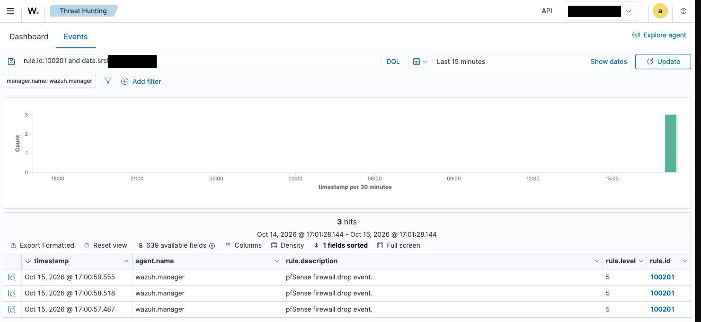

_pfSense block events in Wazuh; address redacted._

### 5. Pi-hole logs into Wazuh — Date: ____

- [ ] Check whether the Wazuh agent supports the Pi's 32-bit ARM
- [ ] Choose agent or rsyslog, and write the reason down
- [ ] DNS queries from an IoT device show up in the dashboard
- [ ] Evidence: screenshot of a Pi-hole query in Wazuh

```
# notes, commands, output
```

**Screenshots**

_Placeholder: Pi-hole query in Wazuh_ — a DNS query from another VLAN  
<!--  -->

### 6. CIS baseline: sort, fix, re-scan — Date: ____

- [ ] Run the CIS scan on the Wazuh server and the MacBook Air; record the starting score
- [ ] Sort every failed check: fix now, fix with a script, or accept with a reason
- [ ] Fix the first batch
- [ ] Re-scan and record the before and after scores
- [ ] Evidence: before and after screenshots

| Host | Before | After | Fixed | Accepted (with reason) |
|---|---|---|---|---|
| Wazuh server (5420) | | | | |
| MacBook Air | | | | |

**Screenshots**

_Placeholder: CIS before_ — the first scan result  
<!--  -->

_Placeholder: CIS after_ — the re-scan after the first batch of fixes  
<!--  -->

### 7. Tuning log — Date: ____

Which alerts I keep, which I silence, and why. One row per decision.

| Date | Alert / rule | What triggered it | Decision (keep / silence / tune) | Why |
|---|---|---|---|---|
| | | | | |

### 8. Verification matrix — Date: ____

Screenshot every result.

| # | Test | From | What I do | Expected | Actual | Pass |
|---|---|---|---|---|---|:-:|
| 1 | Agents report in | Wazuh server, MacBook Air | Check the agents list | Both active | | ☐ |
| 2 | File integrity alert | Wazuh server | Change a monitored file | Alert in the dashboard | | ☐ |
| 3 | pfSense block shows up | Guest or IoT device | Try a blocked connection | Event in Wazuh | | ☐ |
| 4 | Pi-hole queries show up | IoT device | Look up a domain | Query in Wazuh | | ☐ |
| 5 | Agent ports closed to other VLANs | Guest or IoT device | Try the agent port | Fails | | ☐ |

### 9. Write-up — Date: ____

- [ ] Roadmap in the README ticked off, only for what has evidence
- [ ] Network diagram updated to show the log flow
- [ ] "Problems I hit" section completed from the entries below
- [ ] README status changed from planned to done (only after the matrix passes)
- [ ] Portfolio site Wazuh card updated

## Result

_Fill in once the verification matrix has been run._

- Outcome:
- Verification matrix: __ of 5 passed
- What I would do differently:
- Lesson learned:

---

## Problems I hit

One STAR entry per problem. Copy the blank entry for each new one.

### Problem 1: Mac lost its route to other VLANs after switching networks

**Date:** 2026-10-15

**Situation** — From the wired Mgmt port I couldn't ping or SSH to the Pi-hole on Servers.

**Task** — Work out whether the fault was the Pi-hole, pfSense, the switch or the Mac.

**Action** — Pinged the Pi-hole from pfSense (Diagnostics > Ping) with source SERVERS, then source LAN; both replied, so the Pi-hole and routing were fine. On the Mac, `route -n get` returned "not in table" and there was no default route. Renewing DHCP didn't help; replugging the USB Ethernet adapter did.

**Result** — Default route restored and the Pi-hole was reachable again. Lesson: test from the firewall first to split network faults from client faults.

### Problem 2: Changing the admin password after the first start

**Date:** 2026-10-15

**Situation** — The dashboard refuses to change the password of the reserved `admin` user.

**Task** — Replace the default credentials.

**Action** — Tried the CLI procedure: make a hash, put it in `internal_users.yml`, match `docker-compose.yml`, then run `securityadmin.sh`. Pasting multi-line blocks into a hidden password prompt swallowed lines and wrote a junk value. I tore the stack down (`docker compose down -v`), re-cloned the repo, and set the password before the first start, using one-line steps and length checks.

**Result** — Clean stack, and login with the new password works. Lesson: set credentials before the first start, and never paste multi-line blocks into an interactive prompt.

### Problem 3: The new rule didn't work at first

**Date:** 2026-10-15

**Situation** — After adding the rule, every port from the Mac to the Wazuh server timed out.

**Task** — Find out whether the rule or the Mac was wrong.

**Action** — Checked the Mac's address. It still had its old DHCP lease, not the new static mapping. Renewed the lease (System Settings > Wi-Fi > Details > TCP/IP > Renew DHCP Lease).

**Result** — The Mac got its reserved address and the tests passed. Lesson: after a static mapping, renew the client's lease before testing rules that depend on it.

### Problem 4: The MacBook Air still had an agent from the first build

**Date:** 2026-10-15

**Situation** — The installer reported an upgrade, not a new install, and the agent didn't connect to the new server.

**Task** — Point the old agent at the new Wazuh server.

**Action** — Found the old server address in `/Library/Ossec/etc/ossec.conf` and replaced it. Cleared the old key in `client.keys`, then restarted the agent.

**Result** — The agent registered with the new server and shows active. Lesson: check for leftovers from earlier builds before installing; an upgrade keeps the old settings.

### Problem 5: Docker didn't see the edited manager config

**Date:** 2026-10-15

**Situation** — After adding the syslog block and restarting, the manager still only listened on 1514.

**Task** — Get the new config into the container.

**Action** — Compared the host file with the container's copy (1 vs 0). `sed -i` writes a new file, so the single-file bind mount kept pointing at the old one. Recreated the container (`docker compose up -d --force-recreate wazuh.manager`).

**Result** — The manager listened on 514/UDP. Lesson: after editing a bind-mounted single file with `sed -i`, recreate the container, not just restart it.

### Problem 6: pfSense logs arrived but never became alerts

**Date:** 2026-10-15

**Situation** — `tcpdump` showed syslog packets from pfSense, but no pfSense events in the dashboard.

**Task** — Find where the logs were dropped.

**Action** — Ran a captured line through `wazuh-logtest`. pfSense's BSD format has no hostname, so Wazuh read `filterlog[pid]:` as the hostname and its built-in pf decoder never matched. The same line with a hostname matched rule 87701; RFC 5424 format did not decode. Wrote a custom decoder (`pf-nohost`) and two rules. A first version anchored with `^` didn't match; removing the anchor fixed it.

**Result** — pfSense blocks now show as rule 100201 in Wazuh. Lesson: test log formats with `wazuh-logtest` before blaming the network.

---

**Tags:** `wazuh` `siem` `docker` `pfsense` `syslog` `pihole` `cis-benchmarks` `mitre-attack` `homelab`
